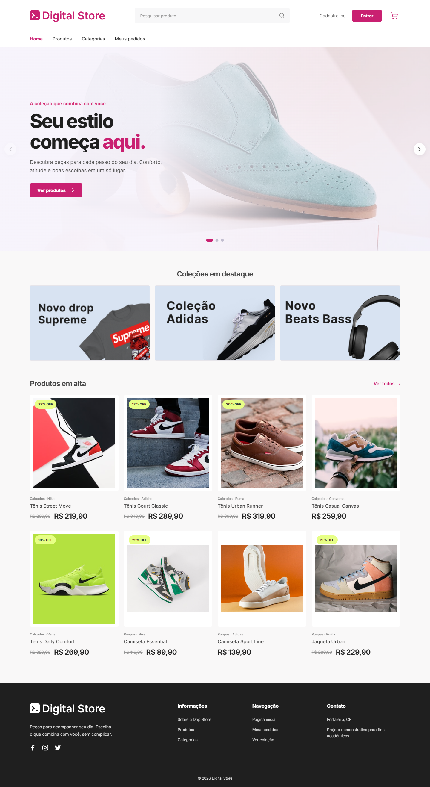
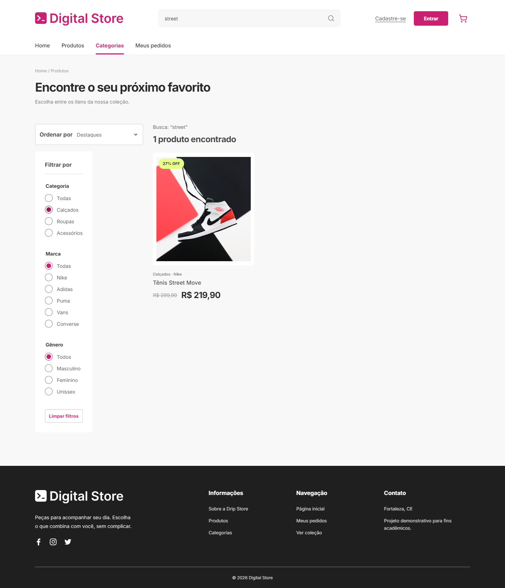
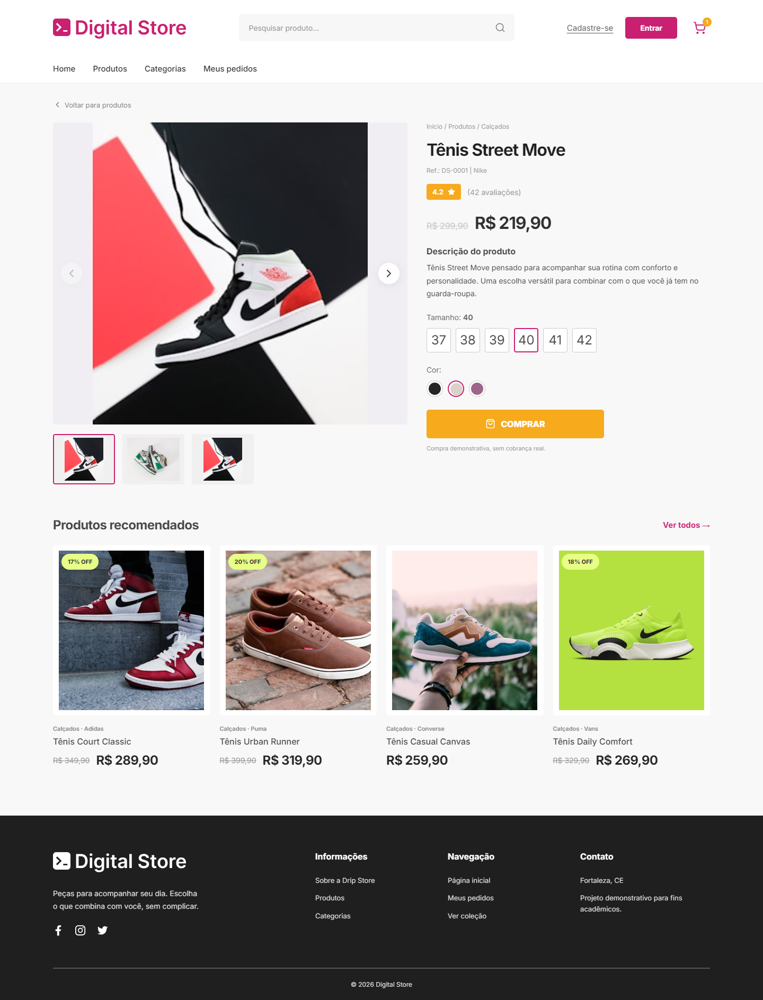

# Digital Store

Projeto final de Front-end da Digital College: uma loja virtual demonstrativa de calçados, roupas e acessórios. O catálogo é local e a aplicação não inclui backend, banco de dados, login real ou pagamentos.

## Integrante

- **Edson Monteiro** — proprietário da conta GitHub [@Edsmonteiro](https://github.com/Edsmonteiro)

## Tecnologias

- React 18 e JavaScript
- Vite
- React Router DOM
- CSS
- Lucide React

## Páginas e funcionalidades

- **Home (`/`)**: carrossel, três coleções em destaque e oito produtos em alta.
- **Produtos (`/products` e `/produtos`)**: busca pela query string `?filter=`, filtros de categoria, marca e gênero, ordenação por preço e cartões de produto.
- **Produto (`/product/:id`)**: galeria com setas e miniaturas, avaliações, preços, seleção de tamanho e cor, botão demonstrativo e recomendações.
- Cabeçalho responsivo com navegação, pesquisa e carrinho demonstrativo.
- Carrinho e pedidos simulados no navegador, sem transações ou envio de dados.

## Capturas de tela

Capturas reais em desktop (1440px), geradas durante os testes de navegador:

**Home**



**Listagem de produtos**



**Visualização do produto**



## Instalação e execução

Requer Node.js 20 ou superior.

```bash
npm install
npm run dev
```

Para gerar a versão de produção e executar os testes unitários do catálogo:

```bash
npm run build
npm test
npm run test:e2e
```

## Estrutura do projeto

```text
src/
  components/  componentes reutilizáveis da loja
  context/     estado local do carrinho
  data/        catálogo de demonstração
  lib/         filtros e formatação de preços
  pages/       Home, listagem, produto e páginas auxiliares
  App.jsx      rotas da aplicação
  styles.css   estilos e breakpoints responsivos
tests/         testes do catálogo
```

## Referências

- [Documentação oficial da Digital College](https://github.com/digitalcollegebr/projeto-digital-store)
- [Arquivo de design no Figma](https://www.figma.com/design/nUk0ihM3x4u8JQtxUoAEJf/DRIP-STORE---DIGITAL-COLLEGE--Copy-?node-id=22-30&p=f)
- [Protótipo no Figma](https://www.figma.com/proto/nUk0ihM3x4u8JQtxUoAEJf/DRIP-STORE---DIGITAL-COLLEGE--Copy-?node-id=22-30)
- Demonstração: ainda não publicada.

## Limitações conhecidas

- O catálogo é estático e as imagens oficiais são servidas pelo repositório público da Digital College; a exibição delas depende de conexão com a internet.
- Conta, pedidos e compra são demonstrações locais. Não há backend, banco de dados, autenticação ou pagamento real.
- O Figma permite visualizar os quadros, mas não expõe as camadas e medidas ao leitor de tela sem uma sessão autenticada. A comparação visual cobre as telas e proporções visíveis; a inspeção detalhada de espaçamentos e estilos internos permanece pendente.

## Testes de navegador

`npm run test:e2e` usa Playwright com o Microsoft Edge instalado na máquina. Os testes cobrem as rotas principais, pesquisa e filtros, navegação da galeria, seleção das opções, carrinho demonstrativo, carregamento das imagens, console e rolagem horizontal nos breakpoints de 1440, 1366, 1024, 768, 390 e 375 pixels.

**Prazo acadêmico:** 20/11/2026.
