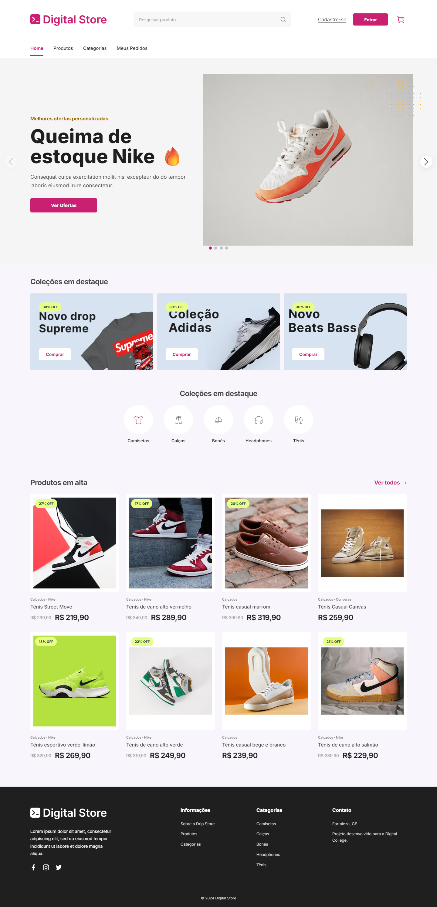
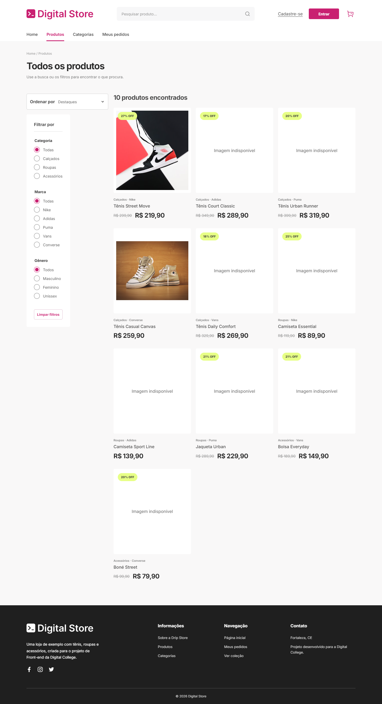
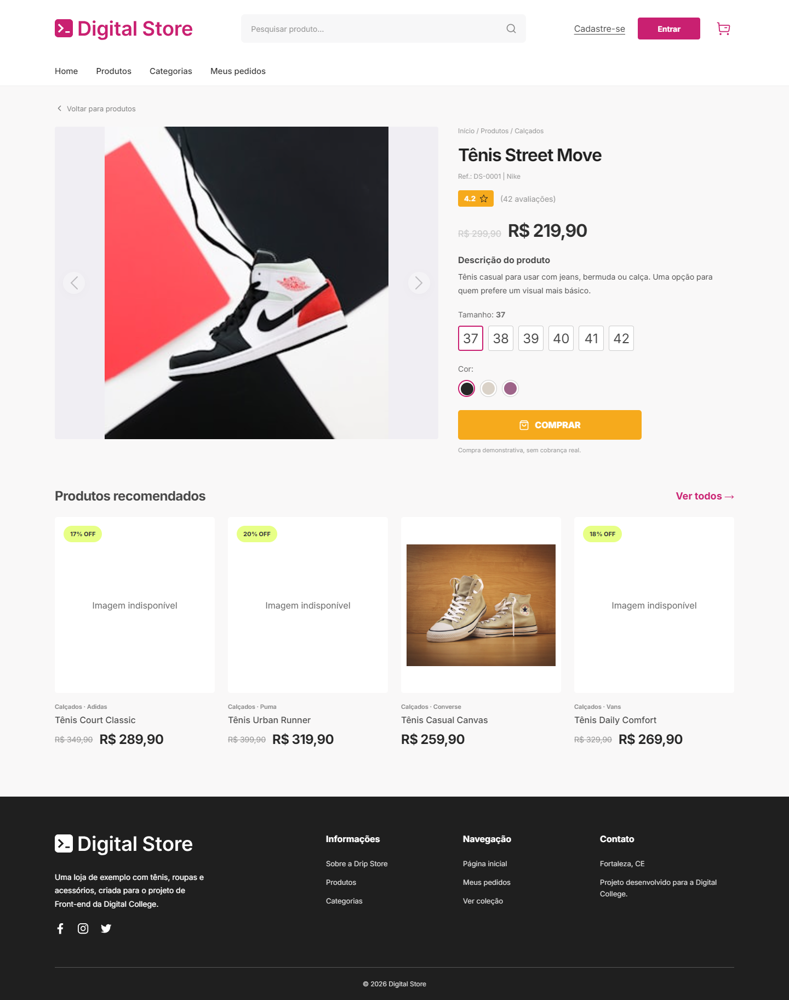

# Digital Store — Front-end

Projeto de Front-end da Digital College, desenvolvido por Edson Monteiro.

A ideia foi montar as três páginas de uma loja virtual: início, catálogo e detalhes de um produto. Usei React e mantive os dados em um arquivo local para trabalhar primeiro a navegação, os componentes e o layout.

**[Abrir a loja](https://digital-store-frontend-iota.vercel.app)** | [Enunciado da atividade](https://github.com/digitalcollegebr/projeto-digital-store) | [Back-end do projeto](https://github.com/Edsmonteiro/digital-store-backend)

## O que dá para fazer

Na **Home**, há um carrossel, três coleções e oito produtos em destaque. No **catálogo**, é possível pesquisar, filtrar por categoria, marca ou gênero e ordenar por preço. Na página do **produto**, dá para trocar as imagens, selecionar cor e tamanho e adicionar o item ao carrinho.

Também deixei um fluxo simples de pedidos para testar a navegação. Ele funciona apenas no navegador: não existe login, pagamento ou compra real.

## Telas

| Home | Catálogo | Produto |
|---|---|---|
|  |  |  |

## Tecnologias

React 18, JavaScript, Vite, React Router DOM, CSS e Lucide React.

Organizei a aplicação em `src/components` (partes reutilizáveis), `src/pages` (telas), `src/data` (produtos de exemplo), `src/lib` (busca e filtros) e `src/context` (carrinho).

## Rodar no computador

Com Node.js 20 ou superior instalado:

```bash
npm install
npm run dev
```

Para verificar o projeto:

```bash
npm run build
npm test
npm run test:e2e
```

Os testes de navegador usam Playwright: Edge no Windows e Chromium no GitHub Actions. Eles passam pelas três páginas e verificam busca, filtros, galeria, carrinho, imagens e tamanhos de tela de 375 a 1440 px.

## O que ficou fora do escopo

Este repositório é a parte visual do trabalho. Os produtos são fictícios e as imagens vêm dos arquivos públicos da Digital College. O [Back-end](https://github.com/Edsmonteiro/digital-store-backend) foi feito em um projeto separado e ainda não alimenta esta loja.

O layout segue os exemplos e medidas fornecidos na atividade. A comparação detalhada com o arquivo original do Figma ainda depende de acesso ao design; por isso, não considero a fidelidade visual pixel a pixel totalmente verificada.

**Referências:** [requisitos oficiais](https://github.com/digitalcollegebr/projeto-digital-store) · [design no Figma](https://www.figma.com/design/nUk0ihM3x4u8JQtxUoAEJf/DRIP-STORE---DIGITAL-COLLEGE--Copy-?node-id=22-30&p=f)

Prazo da atividade: 20/11/2026.
